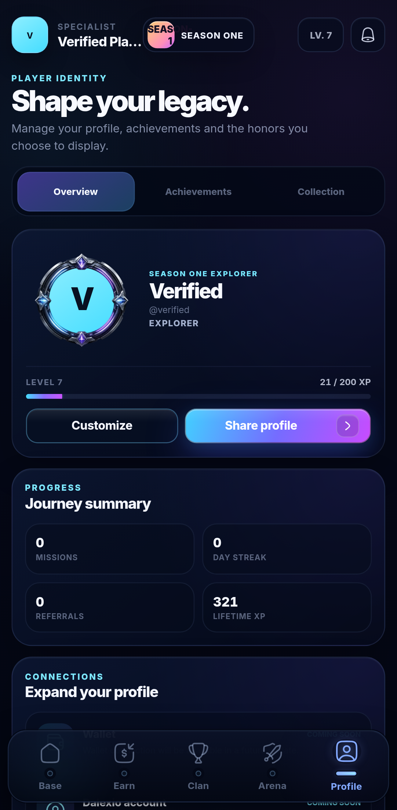
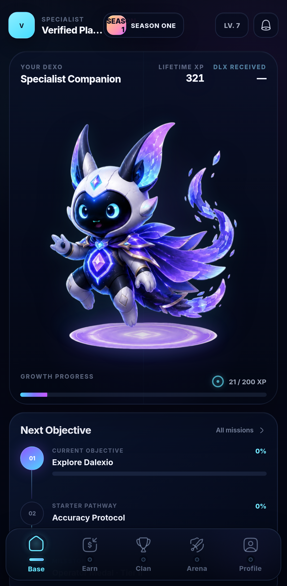
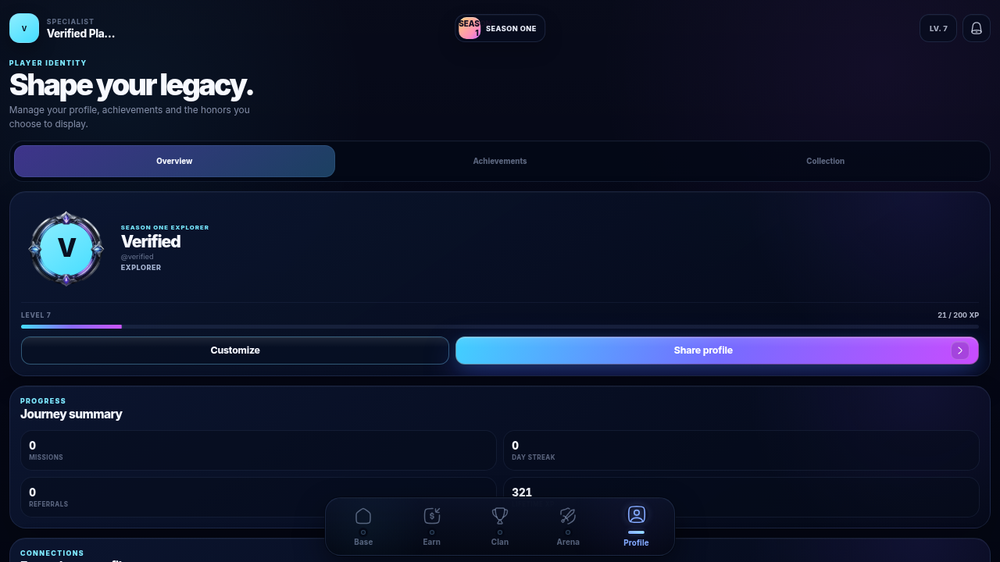

# B3 frontend integration — work in progress

One dedicated frontend branch: `ai/b3-frontend-integration`, based on merged B2
`ba2cdabcf30fe3d99fd8f43159c1422f2c0175d4`. **B3 is not complete or rollout-ready.**
Partner [WEDCAL Draft #28](https://github.com/hassan-anari/WEDCAL/pull/28) is publishing
incremental contracts. The initial session slice is pinned to
`b443eee0174ce495b8de02dbb065aaec19405094`; the final whole-B3 pin remains pending.

## Completed independent client changes

- Reuse the approved recovery screen/background/buttons with natural ownership,
  moved-session, connection, storage, local-tab and Telegram-renewal states.
  Transport details/codes are not rendered as player copy. No Launch Diagnostics.
- Coalesce repeated retries/online/resume calls, show calm busy status and prevent
  accidental duplicate submissions. Durable journals/keys are preserved.
- Integrate real additive B3 ownership, explicit generation-checked takeover after
  a separate confirmation, and exact-generation best-effort release only for an
  acknowledged session. No automatic takeover; a fenced client stays recoverable.
- Apply shared existing cyan/cyan-soft/navy tokens to avatar initials. Preserve
  dimensions, shape, frames, cropping, typography and actual photo rendering.
- Remove Critical Action from the Season 1 route, and reject old persisted true
  flags in the store. Retain future artwork/style assets and unrelated Clan features.
- Public promo placement ignores legacy local flags and renders nothing until the
  real managed banner contract is published. The existing development preview is
  compile-time isolated from production; no public placeholder or reserved slot.
- Extend the existing storage compatibility lifecycle to `b3-1`; preserve onboarding,
  scoped Tap/legacy evidence and safe preferences. Revalidate HTML/client metadata;
  prompt on an incompatible release and refuse refresh over pending Tap evidence.
  Immutable versioned asset/SDK caching is retained.
- Disable automatic Vercel deployment for this branch. No deployment is requested.

## Endpoint / route matrix

| Frontend surface | Exact backend contract | Current status |
| --- | --- | --- |
| Base / recovery | GET `/api/v1/base/v2/tap-state?session_id=UUID` | Integrated B2 + B3 ownership |
| Explicit switch | POST `/api/v1/base/v2/tap-leases`, `takeover:true`, observed `expected_generation` | Integrated, separate user confirmation |
| Ordinary retry | State/replay + `tap-leases` with `takeover:false` | Integrated; never deliberate takeover |
| Close/reopen | POST `/api/v1/base/v2/tap-release` with exact lease/session/generation | Best effort; never release uncertain pending data |
| Tap settlement | POST `/api/v1/base/v2/tap-batches` | B2 exact-body receipt/idempotency preserved |
| Daily | Existing `/daily`, `/daily/claim` | B3 typed settlement contract/fixtures pending |
| Missions | Existing `/missions` and key start/verify/claim | B3 availability/verification/settlement contract pending |
| Typing | Existing `/typing`, attempt start/submit, claim | B3 resume/expiration/settlement contract pending |
| Referral | Existing `/referrals` | B3 invitee/eligibility/earnings contract pending |
| Creator / Network | Existing `/network/groups`, intents, reverify | B3 metrics/eligibility/read model pending |
| Promo banner | No published endpoint | Entire API/fixtures pending; public banner safely absent |
| Base/Header/Profile canonical data | Bootstrap + B2 Tap cache bridge | Existing receipt tuple ordering retained; B3 non-Tap binding pending |

Pending adapters are deliberately not implemented from invented fields. Existing
production demo Earn/Network consumers still require replacement before completion;
this branch must not be merged/deployed in its intermediate state.

## Evidence so far (not a final acceptance claim)

- TypeScript passed; initial full check passed before the session adapter additions.
  165 unit tests passed at that intermediate state; 35 focused controller/session
  tests passed after integration. Full final-head validation will supersede counts.
- Production B1/client browser matrix: 60 passed initially, four fixture failures
  corrected. Focused rerun: 10 passed, including no-photo, blocked origin, expired
  cache fallback and incompatible-release/pending-journal protection on mobile/desktop.
- Initial actual PostgreSQL B3 session slice: three new scenarios passed, plus
  all 15 existing B2 paired regressions (18 total). The initial midnight/cooldown
  timeout under concurrent browser load passed on an isolated rerun with the
  unchanged 5-second deadline. All seven production paired-browser scenarios passed,
  including real Mobile/Desktop switching/repeated Retry/close-both/reopen.
  No assertions/timeouts were weakened.
- Initial synthetic isolated API measurements: switch 116.98 ms; close/reopen after
  acknowledged release 109.44 ms. These are local API measurements, not production
  Telegram guarantees. Passive expiry remains the backend's configured 120 seconds
  if closure release cannot be delivered; explicit switching provides immediate
  user-directed recovery when supported and reachable.
- Real backend/browser full B3 Daily/Missions/Typing/Referral/Creator/banner tests,
  final CI links and complete final backend pin remain pending.

Focused visual evidence uses only synthetic identities and existing approved assets:

## Visual preservation / operational dependencies

No layout, spacing, artwork, navigation, motion timing, Dexo effects, haptics, input
experience or unrelated UI redesign. Only the authorized fallback colors, recovery
copy/actions, diagnostics removal and Season 1 visibility changes are included.
No visual baseline is regenerated. No public reward requests, merge, deployment,
live reset, bot Admin duplicate or public rollout has occurred.

Complete and review the backend contracts and fixtures, pin the final reviewed SHA,
finish real data consumers and paired PostgreSQL/browser proof, obtain final-head
CI, then stop for independent review. Backend-first compatible rollout and real
Telegram Mobile/Desktop/VPN-off device verification remain owner-controlled gates.

## Checkpoint follow-up

Hosted initial-head validation at `38ec72b`:
[run 38702419194](https://github.com/hassan-anari/FROCAL/actions/runs/38702419194).
Unit/build, pinned B2 and pinned B3 jobs passed. Browser matrix had 110 passing
scenarios and two identical bounded-retry fixture failures: the synthetic Tap
snapshot used a different Season/config and correctly triggered a Bootstrap refresh.
The fixture now matches its verified Bootstrap Season/config/progression policy;
the original exact three-attempt assertion is retained. Focused mobile/desktop
rerun passed all four affected/related cases. Final-head CI will supersede this run.

Further fallback inspection found secondary Clan/applicant/group image containers
without load-failure recovery. They now reuse the existing bounded avatar delivery
hook, preserve the same elements/sizes/frames/cropping and use the same cyan tokens.
Earn referral image fallback also uses that shared path. No replacement photo URL
or extra fallback request is constructed. A shared navigation validator rejects
unsafe URLs, keeps internal targets on existing game routes and dispatches exact
Telegram hosts through the Telegram adapter. It does not define pending API fields.
